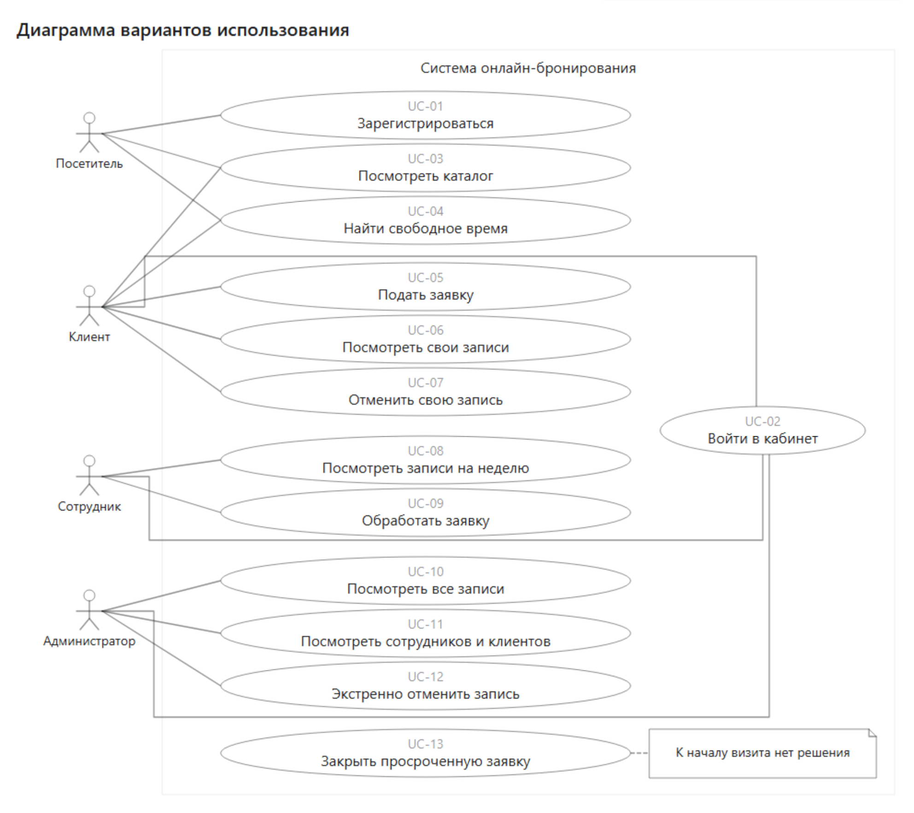

# Варианты использования системы онлайн-бронирования

В MVP одна организация принимает онлайн-записи на услуги фиксированной длительности. Клиент выбирает время, специалист принимает решение по заявке, администратор видит записи всей организации и может отменить запись в критической ситуации.

## Акторы и общие правила

| Актор | Доступ |
| --- | --- |
| Посетитель | Регистрируется, просматривает услуги и ищет свободное время. |
| Клиент | Подаёт заявки, просматривает и отменяет свои записи. |
| Сотрудник | Просматривает записи по своим услугам и принимает решения по своим заявкам. |
| Администратор | Просматривает записи, сотрудников и клиентов организации. В критической ситуации отменяет запись. |

- У каждого сотрудника задан фиксированный рабочий график и список услуг. В общем календаре видны свободные интервалы. Сведения о клиентах и записях доступны в личных кабинетах согласно роли.
- Клиент регистрируется самостоятельно. Учётные записи сотрудников и администратора создаются заранее.
- Система измеряет нагрузку специалиста за выбранный день по сумме минут подтверждённых записей и заявок, ожидающих подтверждения.
- Заявка сразу занимает интервал и получает статус **«Ожидает подтверждения»**. Подтверждение сохраняет интервал занятым. Отклонение или отмена освобождает его, если интервал не закрыт из-за недоступности сотрудника.
- Клиент может отменить свою ожидающую или подтверждённую запись до начала визита. Для другого времени он оформляет новую заявку.
- Экстренная отмена получает статус **«Отменена»** с отметкой **«Отменена администратором»**. Если специалист временно недоступен, система закрывает конкретный интервал на эту дату. Рабочий график остаётся фиксированным.
- Если сотрудник не принял решение к началу визита, система отменяет заявку с причиной **«Срок подтверждения истёк»**.

## Диаграмма вариантов использования

## Общие сценарии

### UC-01. Зарегистрироваться

**Актор** — посетитель. **Результат** — создана учётная запись клиента.

1. Посетитель открывает форму регистрации и вводит имя, электронную почту и пароль.
2. Система проверяет данные и доступность адреса.
3. Система создаёт учётную запись с ролью клиента и предлагает войти.

**Альтернативный ход.** Посетитель с существующей учётной записью переходит ко входу.

**Ошибки.** Если адрес уже используется или данные не проходят проверку, система сообщает об этом и предлагает исправить данные либо войти. Новая учётная запись не создаётся.

[Диаграмма активности UC-01](diagrams/uc-01.png)

### UC-02. Войти в личный кабинет

**Акторы** — клиент, сотрудник, администратор. **Предусловие** — у актора есть учётная запись.

1. Актор вводит электронную почту и пароль.
2. Система проверяет данные и определяет роль по учётной записи.
3. Система открывает личный кабинет с функциями этой роли.

**Альтернативный ход.** При действующем сеансе система сразу открывает кабинет.

**Ошибки.** При неверных данных система сообщает, что вход не выполнен, и предлагает повторить попытку. При попытке открыть раздел другой роли система отказывает в доступе.

[Диаграмма активности UC-02](diagrams/uc-02.png)

## Сценарии клиента

### UC-03. Посмотреть услуги и специалистов

**Актор** — посетитель или клиент. **Результат** — выбрана услуга или специалист для поиска времени.

1. Актор открывает каталог.
2. Система показывает услуги, их длительность и специалистов, которые их оказывают.
3. Актор выбирает услугу и переходит к поиску доступного времени.

**Альтернативный ход.** Актор начинает со специалиста и выбирает услугу из его списка.

**Ошибки.** Если список не загрузился, система предлагает повторить загрузку. Если по выбранному фильтру нет услуг или специалистов, система показывает пустой результат и предлагает изменить выбор.

[Диаграмма активности UC-03](diagrams/uc-03.png)

### UC-04. Найти свободное время

**Актор** — посетитель или клиент. **Предусловие** — выбраны услуга и дата.

1. Система находит сотрудников, оказывающих выбранную услугу.
2. Для каждого сотрудника система определяет интервалы, в которые услуга целиком помещается, с учётом рабочего графика, заявок, подтверждённых записей и экстренно закрытых интервалов.
3. Среди сотрудников со свободным временем система выбирает наименее загруженного за этот день. При равной нагрузке предлагает специалиста с ближайшим свободным временем.
4. Актор видит имя предложенного специалиста и выбирает подходящий интервал.

**Альтернативный ход.** Если актор выбрал конкретного специалиста, система показывает его свободное время для выбранной услуги.

**Ошибки.** Если свободного времени нет, система предлагает другую дату или специалиста. Если услуга недоступна у выбранного специалиста, система предлагает изменить выбор. Прошедшее время и интервалы, в которые услуга целиком не помещается, недоступны для выбора.

[Диаграмма активности UC-04](diagrams/uc-04.png)

### UC-05. Подать заявку на запись

**Актор** — клиент. **Предусловия** — клиент вошёл в кабинет и выбрал услугу, специалиста и время.

1. Система показывает услугу, специалиста, дату, время начала и длительность.
2. Клиент подтверждает отправку заявки.
3. Система повторно проверяет доступность всего интервала и сохраняет заявку со статусом **«Ожидает подтверждения»**. Интервал становится занятым.
4. Клиент видит заявку в своём кабинете, а специалист — в своём списке заявок.

**Альтернативные ходы.** Если клиент возвращается к выбору времени до отправки, его выбор можно изменить. При повторной отправке уже сохранённой заявки система показывает существующую запись.

**Ошибки.** Если другой клиент успел занять пересекающийся интервал или интервал закрыли, система не создаёт заявку и предлагает выбрать другое время. Если сеанс истёк, система предлагает войти снова и повторно проверяет доступность перед сохранением.

[Диаграмма активности UC-05](diagrams/uc-05.png)

### UC-06. Посмотреть свои записи

**Актор** — клиент. **Предусловие** — клиент вошёл в кабинет.

1. Клиент открывает раздел своих записей.
2. Система показывает его предстоящие и прошлые записи с датой, услугой, специалистом и текущим статусом.
3. Клиент открывает нужную запись и видит подробности, включая отметку об отмене администратором или истечении срока подтверждения, если она есть.

**Альтернативный ход.** Если записей ещё нет, система показывает пустой список и предлагает перейти в каталог.

**Ошибки.** При попытке открыть чужую запись по прямой ссылке система отказывает в доступе. Если данные не загрузились, система предлагает повторить запрос.

[Диаграмма активности UC-06](diagrams/uc-06.png)

### UC-07. Отменить свою запись

**Актор** — клиент. **Предусловия** — запись принадлежит клиенту, ожидает подтверждения или подтверждена, а время визита ещё не наступило.

1. Клиент открывает запись и выбирает отмену.
2. Система показывает выбранную запись и запрашивает подтверждение.
3. Система повторно проверяет возможность отмены, присваивает статус **«Отменена»** и фиксирует, что отмену выполнил клиент.
4. Интервал освобождается. Новый статус виден клиенту и специалисту.

**Альтернативные ходы.** Клиент закрывает подтверждение, и запись сохраняется. Если специалист подтвердил заявку, пока окно отмены было открыто, клиент всё ещё может её отменить до начала визита.

**Ошибки.** Если визит уже начался либо запись была отклонена или отменена, система показывает актуальное состояние. Повторная отмена не меняет причину и автора уже выполненной отмены.

[Диаграмма активности UC-07](diagrams/uc-07.png)

## Сценарии сотрудника

### UC-08. Посмотреть свои записи на неделю

**Актор** — сотрудник. **Предусловие** — сотрудник вошёл в кабинет.

1. Сотрудник открывает свой календарь.
2. Система показывает его записи по всем назначенным ему услугам на ближайшие семь календарных дней, включая текущий день.
3. Сотрудник открывает запись и видит время, услугу, клиента и статус. Заявки, ожидающие решения, выделены в календаре.

**Альтернативный ход.** Если на неделю нет записей, система показывает свободный календарь. Сотрудник может открыть ожидающую заявку для обработки.

**Ошибки.** При попытке открыть запись другого сотрудника система отказывает в доступе. Если календарь не загрузился, система предлагает повторить запрос.

[Диаграмма активности UC-08](diagrams/uc-08.png)

### UC-09. Подтвердить или отклонить заявку

**Актор** — сотрудник. **Предусловия** — заявка назначена сотруднику, ожидает подтверждения, время визита ещё не наступило.

1. Сотрудник открывает ожидающую заявку и проверяет услугу и время.
2. Сотрудник подтверждает заявку.
3. Система проверяет актуальный статус и время начала, затем присваивает статус **«Подтверждена»**. Интервал остаётся занятым.
4. Клиент и сотрудник видят статус в своих кабинетах.

**Альтернативный ход.** Сотрудник отклоняет заявку. Система присваивает статус **«Отклонена»**, освобождает интервал и показывает результат клиенту.

**Ошибки.** Если клиент уже отменил заявку, решение сохранено в другой вкладке или срок подтверждения истёк, система показывает актуальное состояние и не применяет повторное решение. Сотрудник не может обработать заявку коллеги.

[Диаграмма активности UC-09](diagrams/uc-09.png)

## Сценарии администратора

### UC-10. Посмотреть все записи организации

**Актор** — администратор. **Предусловие** — администратор вошёл в кабинет.

1. Администратор открывает журнал записей.
2. Система показывает записи организации. Администратор может выбрать период и отфильтровать записи по сотруднику или статусу.
3. При открытии записи система показывает клиента, специалиста, услугу, время, статус и, если применимо, сведения об отмене.

**Альтернативный ход.** Если фильтры ничего не нашли, администратор меняет критерии или сбрасывает их.

**Ошибки.** Если запись по ссылке недоступна, система сообщает об этом и предлагает вернуться к журналу. При сбое загрузки система предлагает повторить запрос.

[Диаграмма активности UC-10](diagrams/uc-10.png)

### UC-11. Посмотреть сотрудников и клиентов

**Актор** — администратор. **Предусловие** — администратор вошёл в кабинет.

1. Администратор открывает справочник сотрудников или клиентов.
2. Система показывает список выбранной категории.
3. В карточке сотрудника система показывает его услуги, рабочий график и связанные записи. В карточке клиента — его имя, электронную почту и связанные записи.

**Альтернативный ход.** Администратор переходит из карточки к записям выбранного сотрудника или клиента. Если их ещё нет, система показывает пустой список.

**Ошибки.** Если карточка по прямой ссылке недоступна, система сообщает об этом и предлагает вернуться к справочнику.

[Диаграмма активности UC-11](diagrams/uc-11.png)

### UC-12. Экстренно отменить запись

**Актор** — администратор. **Предусловия** — возникла критическая ситуация, запись ещё не началась и ожидает подтверждения либо подтверждена.

1. Администратор открывает запись и выбирает экстренную отмену.
2. Администратор указывает причину и отмечает, недоступен ли специалист в выбранный интервал.
3. Система повторно проверяет состояние записи, присваивает статус **«Отменена»** и фиксирует администратора и причину. Клиент и сотрудник видят отметку **«Отменена администратором»**.
4. Если специалист недоступен, система закрывает интервал на эту дату, и он исчезает из доступного времени.

**Альтернативный ход.** Если причина касается только конкретной записи, а специалист доступен, интервал снова появляется в календаре.

**Ошибки.** Без причины система не принимает экстренную отмену. Если запись уже отменена, отклонена или визит начался, система показывает текущее состояние. При сбое система сохраняет прежнее состояние записи и интервала. Экстренная отмена с закрытием времени применяется целиком.

[Диаграмма активности UC-12](diagrams/uc-12.png)

## Автоматический сценарий

### UC-13. Закрыть заявку, срок подтверждения которой истёк

**Запуск** — наступило время визита, а заявка всё ещё ожидает подтверждения.

1. Система проверяет время начала и актуальный статус.
2. Система присваивает статус **«Отменена»** и фиксирует причину **«Срок подтверждения истёк»**.
3. Клиент и сотрудник видят причину в кабинетах. Заявка больше не ожидает решения.

**Альтернативный ход.** Если специалист успел подтвердить или отклонить заявку до начала визита либо заявка уже отменена, система сохраняет принятое решение.

**Пограничный случай.** При одновременном подтверждении и истечении срока действует время начала визита. Подтверждение принимается только до этого момента.

[Диаграмма активности UC-13](diagrams/uc-13.png)
